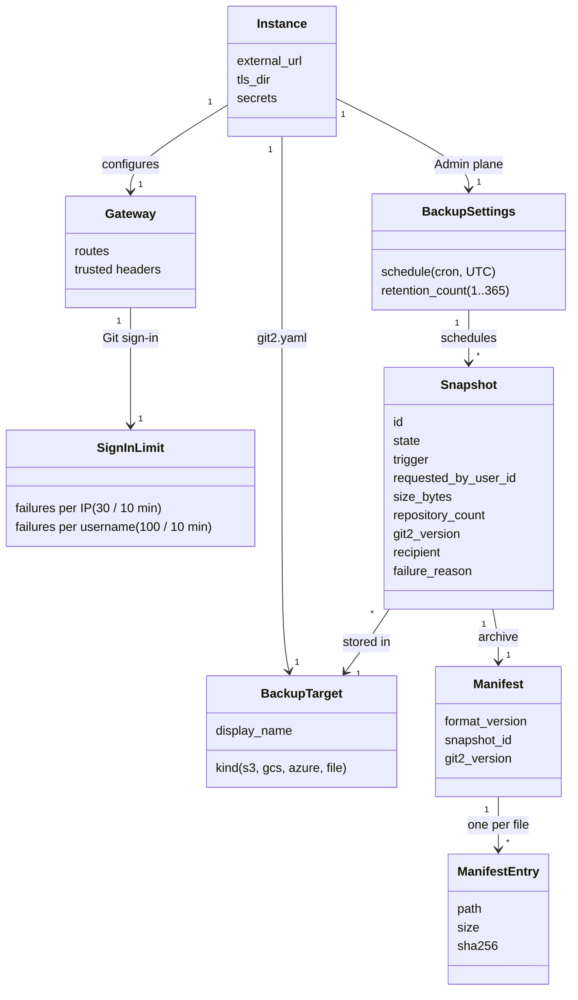
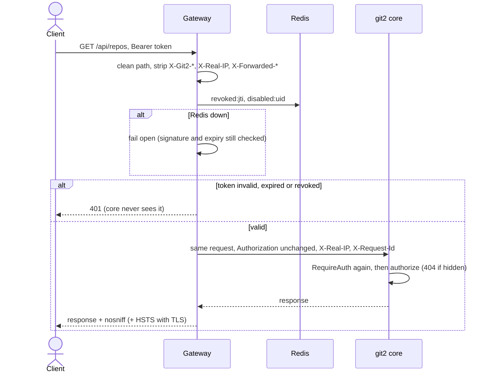
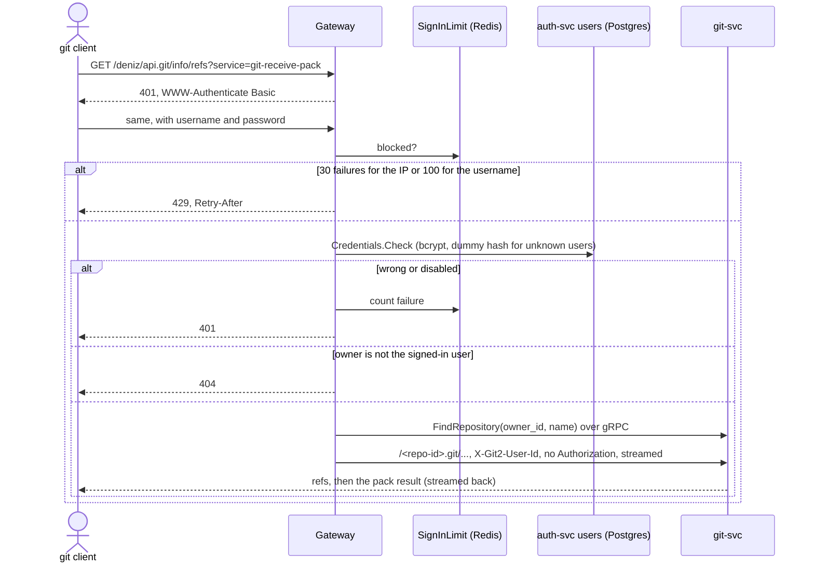
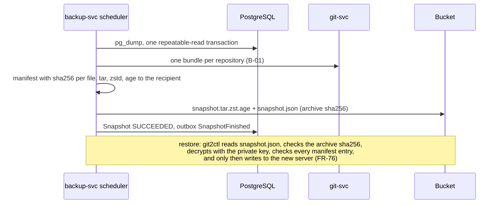
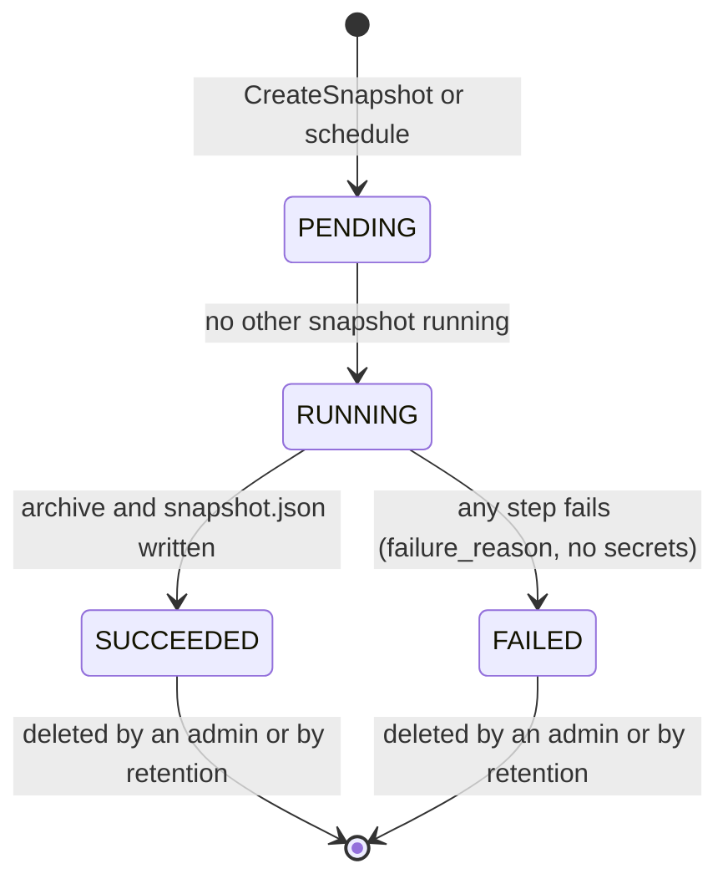

# Requirement Analysis: Platform & Backup lane (draft)

The Platform & Backup section of the Requirement Analysis Report (WBS-18.5, due 23 Nov, editor Beste). It analyses the lane's requirements from the Requirements Specification (git2 `RequirementsSpecification.md`, as amended in git2#23) into objects, interactions and states. Owner: Ceyda. **Draft:** sent to the editor by 20 Nov; the shared report decides the final layout.

## 1. Scope

| Area | Requirements | Use cases | Built or specified in |
|---|---|---|---|
| Gateway | FR-02, FR-03, FR-05, FR-99, NFR-04, NFR-35 | UC-09, UC-11 (gateway part) | git2#21, #24, #25; [gateway.md](../api/gateway.md) |
| Packaging | FR-77, FR-78, FR-79, FR-80, FR-81, FR-82, NFR-15, NFR-24, NFR-25 | UC-01, UC-02 | git2-deploy#6, #14, #15, #18; [compose.md](../api/compose.md), [git2ctl.md](../api/git2ctl.md) |
| Backup and restore | FR-70 to FR-76, FR-100, NFR-05, NFR-21, NFR-23, NFR-26 | UC-25, UC-26 | [backup.md](../api/backup.md), [snapshot-format.md](../api/snapshot-format.md) (W4 onward) |

## 2. Analysis object model

Entity objects only; boundary objects are the gateway's routes and git2ctl's commands, control objects are backup-svc's scheduler and git2ctl's installer.



Analysis decisions:
- **`Instance` is `git2.yaml`.** The destination, its credentials and the age public key live there, not in the database, so the Admin plane changes only `BackupSettings` (FR-65, FR-100) and a restore needs only the bucket and the private key.
- **`Snapshot` is backup-svc's record of a run** (FR-74). A `SUCCEEDED` snapshot is the only kind a restore may use.
- **No user or repository object belongs to this lane.** The gateway reads auth-svc's users through `authsvc.Credentials` and asks git-svc for repository IDs; it stores nothing but failure counters.

## 3. Dynamic model

### 3.1 UC-09: an API call through the gateway



### 3.2 UC-11: git push through the gateway



### 3.3 UC-01: git2ctl install

```mermaid
sequenceDiagram
    actor Op as Operator
    participant C as git2ctl
    participant D as Docker / Compose
    participant GW as Gateway
    Op->>C: install --url https://host --tls-dir dir
    C->>D: docker info, compose version
    C->>C: no git2.yaml yet, TLS files, ports free
    alt a check fails
        C-->>Op: names the prerequisite; nothing written
    else
        C->>C: git2.yaml and .env (0600, new secrets), compose/ and images/
        C->>D: compose up -d --build
        loop until ready or timeout
            C->>GW: /api/auth/me (401 = core answers), /readyz
        end
        C-->>Op: address, or compose ps and "containers left for the logs"
    end
```

### 3.4 UC-25 and UC-26: snapshot and restore (W4 onward, from the contract)



Database first, repositories second: a repository created in between has no row and git-svc's sweeper removes it after a restore. The other order would leave rows pointing at missing repositories (FR-71).

### 3.5 Snapshot states



At most one snapshot is `PENDING` or `RUNNING` (a second `CreateSnapshot` gets `ABORTED`). Lowering the retention deletes old snapshots only after the next one reaches `SUCCEEDED` (FR-100).

## 4. Findings from the analysis

| # | Finding | Resolution |
|---|---|---|
| 1 | The spec had the Admin plane set the backup destination and credentials; backup.v1 keeps them in `git2.yaml`. | Spec follows the contract (git2#23: FR-65, UC-25, SC-10). |
| 2 | FR-03 tests a revoked token for 401; the gateway fails open when Redis is down. | Note in the spec; the test runs with Redis up. Worst case: a revoked token works until it expires (15 min). |
| 3 | FR-27 says Git authenticates with a PAT; PATs come in W6 (WBS-3.2). | v0 uses the account password; PATs replace it for Git in W6 (gateway contract). |
| 4 | The per-username failure limit lets anyone lock an owner out of Git for 10 minutes. | Residual on git2#24 for the team to decide; keying it on (username, IP) removes it but weakens the limit. |
| 5 | Without TLS the gateway serves plain HTTP. | Allowed only on loopback: git2ctl refuses a plain-HTTP URL for any other host (NFR-04). |
| 6 | NFR-15 (install under 10 min) cannot be met by building from source on a slow host. | Published images (WBS-13.4, W8) make install a pull; measured on a clean VM then. |

## 5. Traceability to tests

| Requirement | Check |
|---|---|
| FR-02, FR-99, NFR-35 | Compose smoke checks 4, 5, 7 (only the gateway published; non-root, read-only; client IP, spoofed headers) |
| FR-03 | gateway tests: no, expired, revoked, tampered token; dot-segment and encoded paths |
| FR-27 (via gateway) | smoke check 9: real git push and clone; 401 with challenge; 404 for another owner |
| NFR-04 | smoke check 10: HTTPS with HSTS, TLS 1.1 refused, HTTP 308; git2ctl refuses plain HTTP off loopback |
| FR-77 | git2ctl tests (preflight, files, compose arguments) and the real install run in git2-deploy#18 |
| FR-70 to FR-76, FR-100 | backup-svc and restore tests from W4 (weekly restore test from W5, NFR-23) |

## 6. Open

- ACME or certificate reload (git2-deploy#16).
- Signed download URLs for `/raw`, and who verifies them (gateway contract, open question 1).
- Least-privilege database roles and split networks (ADR 0002), with `git2ctl upgrade` (W4).
